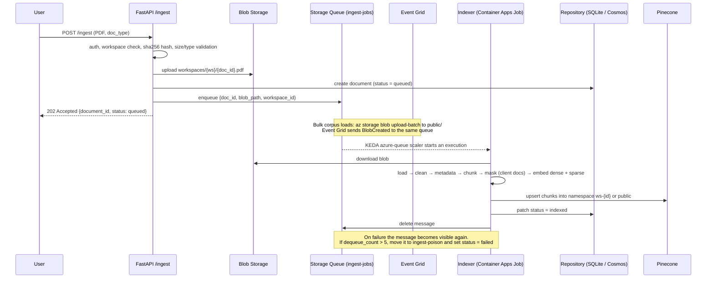
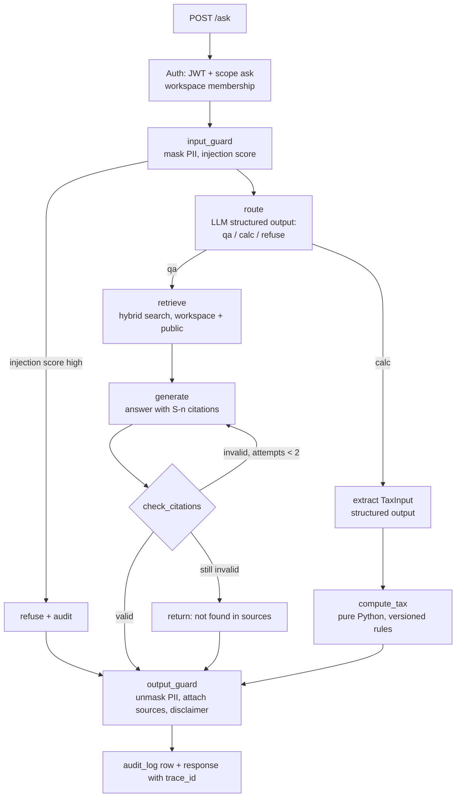
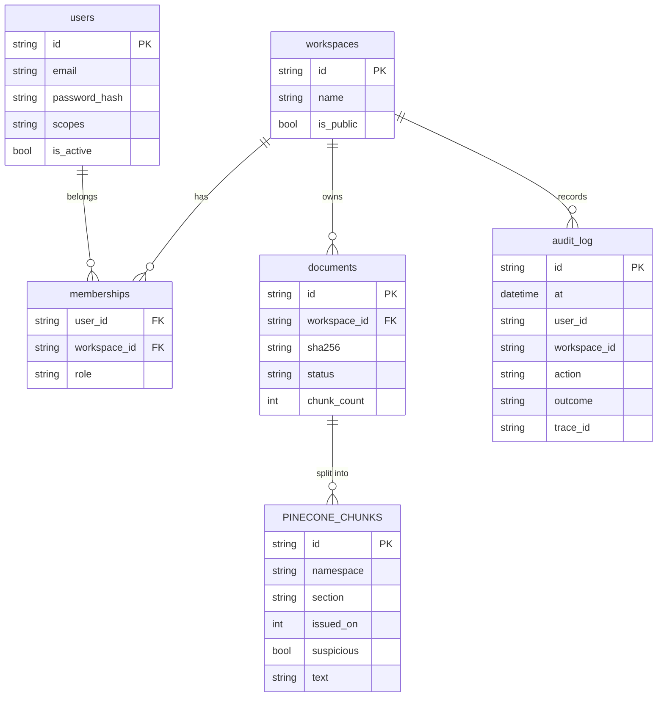

# 1. Architecture

## 1.1 System context

```mermaid
flowchart LR
  client[Client app / Swagger UI] -->|HTTPS + JWT| api[FastAPI API<br/>Container App]
  hermes[Hermes agent] -->|MCP| mcp[TaxLens MCP server]
  mcp -->|HTTPS + service JWT| api

  api --> guard[Input guard<br/>PII mask + injection check]
  guard --> graph[LangGraph router]
  graph --> qa[Q&A path]
  graph --> review[Review path]
  graph --> calc[Tax calculator tool]

  qa --> store[(Pinecone<br/>hybrid index<br/>namespace per workspace)]
  review --> store
  qa --> llm[LLM provider factory<br/>Gemini / Groq / Ollama]
  review --> llm
  calc --> llm

  api -->|upload| blob[(Blob Storage)]
  api -->|enqueue job| queue[[Storage Queue<br/>ingest-jobs]]
  blob -. BlobCreated on public/ .-> eg[Event Grid] -.-> queue
  queue --> job[Indexer<br/>Container Apps Job]
  job -->|read file| blob
  job -->|chunks + embeddings| store

  api --> appdb[(Repository<br/>SQLite local / Cosmos DB cloud<br/>users, workspaces,<br/>documents, audit_log)]
  job -->|status| appdb
  api -. OTLP traces .-> phoenix[Arize Phoenix]
  job -. OTLP traces .-> phoenix
  kv[Key Vault] -. secrets via managed identity .-> api
  kv -.-> job
```

There is no PostgreSQL. Vectors live in **Pinecone**. Relational app data goes through a small
`Repository` interface backed by **SQLite** locally and **Azure Cosmos DB** in the cloud (see § 1.6).

## 1.2 Components

| Component | Runs as | Responsibility |
|-----------|---------|----------------|
| API (`taxlens/api`) | Container App, `uvicorn` | Auth, request validation, workspace checks, audit logging, calls the agent graph |
| Agent (`taxlens/agent`) | in-process with the API | LangGraph state machine: guard → route → (Q&A, review, calc) → citation check → output guard |
| Ingestion (`taxlens/ingestion`) | in the worker | Load PDF → clean → extract metadata → section-aware chunking → embed → upsert |
| Worker (`taxlens/worker`) | Container Apps Job (cloud), compose service (local) | Pull messages from `ingest-jobs` and run the ingestion pipeline. Failed messages go to `ingest-poison` |
| Retrieval (`taxlens/retrieval`) | library | `VectorStore` protocol, Pinecone implementation (dense + SPLADE sparse), section boost with RRF, metadata filters |
| LLM (`taxlens/llm`) | library | Provider factory, fallbacks, embeddings |
| Storage (`taxlens/storage`) | library | `Repository` protocol (SQLite / Cosmos DB), Blob and Queue clients |
| Security (`taxlens/security`) | library | PII masking/unmasking, injection detection, audit writer |
| MCP server (`taxlens/mcp_server`) | separate process (stdio or HTTP) | Exposes TaxLens tools to MCP clients such as your Hermes agent |
| Phoenix | container | Trace UI for latency, tokens, cost and errors |

## 1.3 Replacing the three Azure services

### A. Azure OpenAI → Gemini API (primary) + Groq (fallback) + Ollama (local)

All LLM access goes through one factory, `taxlens/llm/providers.py`, which returns a LangChain
`BaseChatModel`. The rest of the code never imports a provider SDK directly.

| Option | Cost for this project | Strengths | Weaknesses |
|--------|----------------------|-----------|------------|
| **Google Gemini API** (chosen as primary) | Free tier, cheap paid tier | Large context, good structured output, fits your Google goal | Free-tier data may be used by Google to improve products (see the compliance note) |
| **Groq** (chosen as fallback) | Free tier | Very fast Llama / open-weight models, OpenAI-compatible | Rate limits, smaller model choice |
| **Ollama** local Llama (chosen for offline/dev) | Free | No data leaves your machine, works offline, fits your Meta goal | Needs RAM/GPU, lower quality on small models |
| OpenAI API (direct) | Paid | Strong models | No free tier |
| Anthropic Claude API | Paid | Strong at long legal text and citations | No free tier |

How it is wired:

```python
# taxlens/llm/providers.py (sketch)
from langchain_core.language_models import BaseChatModel
from taxlens.config import settings

def _build(provider: str, model: str) -> BaseChatModel:
    if provider == "gemini":
        from langchain_google_genai import ChatGoogleGenerativeAI
        return ChatGoogleGenerativeAI(model=model, temperature=0)
    if provider == "groq":
        from langchain_groq import ChatGroq
        return ChatGroq(model=model, temperature=0)
    if provider == "ollama":
        from langchain_ollama import ChatOllama
        return ChatOllama(model=model, base_url=settings.ollama_base_url, temperature=0)
    raise ValueError(f"Unknown LLM provider: {provider}")

def get_chat_model() -> BaseChatModel:
    primary = _build(settings.llm_provider, settings.llm_model)
    if settings.llm_fallback_provider:
        fallback = _build(settings.llm_fallback_provider, settings.llm_fallback_model)
        return primary.with_fallbacks([fallback])
    return primary
```

**Embeddings stay local.** Use `BAAI/bge-small-en-v1.5` (384 dimensions) through FastEmbed (ONNX,
CPU-only, no PyTorch). Reasons:

- It costs nothing, and the vectors are deterministic, so CI eval results are stable.
- Document text never leaves your infrastructure just to be embedded.
- All three vector backends (Pinecone, Qdrant, Oracle) share the same dense vectors and dimension.
- A **sparse** SPLADE vector (also local through FastEmbed) handles keyword matching in Pinecone.
  See § 1.3 B.
- Changing the embedding model means re-indexing, so the model name is stored on every document
  row (`documents.dense_model`, `documents.sparse_model`).

> **Compliance note.** On the Gemini API free tier, Google may use prompts to improve its products.
> TaxLens masks PII before every LLM call either way, but for real client data you would use a paid
> tier or Ollama. Put this in the README. Check the current Gemini API terms before relying on this
> note.

> **Model names change often.** Keep them in `.env`, never in code. Typical values:
> `gemini-2.5-flash` (Gemini), `llama-3.3-70b-versatile` (Groq), `llama3.1:8b` (Ollama).
> Check each provider's current model list when you start.

### B. Azure AI Search (hybrid) → Pinecone serverless hybrid index

Pinecone is a fully managed vector database. TaxLens uses **one serverless index per environment**
(`taxlens-dev`, `taxlens-ci`, `taxlens-prod`). Each record holds both a dense and a sparse vector,
so one query does both semantic and keyword matching.

| Setting | Value | Why |
|---------|-------|-----|
| Index type | Serverless, `dimension=384`, `metric="dotproduct"` | `dotproduct` is required to put sparse and dense vectors in one index. The BGE vectors are L2-normalised, so the dense part behaves like cosine |
| Dense vector | `BAAI/bge-small-en-v1.5` (local FastEmbed) | Free, deterministic, and shared with the other backends |
| Sparse vector | SPLADE `prithivida/Splade_PP_en_v1` (local FastEmbed) | Keyword-style matching for `80C`, `194J`, `Circular No. 3/2025`, with no fitting step and no API quota |
| Namespaces | `public` for the government corpus, `ws-<workspace_uuid>` per client | Tenant isolation. A query only touches namespaces the caller may see, and deleting a client means deleting one namespace |
| Record id | `{document_id}#{chunk_no:05d}` | Lets you list and delete a document's chunks by id prefix (`index.list(prefix=...)`) |
| Metadata | `document_id`, `workspace_id`, `doc_type`, `act`, `section`, `circular_no`, `notification_no`, `issued_on` (int `YYYYMMDD`), `page`, `source_url`, `suspicious`, `text` | Used for filters and citations. `text` is stored so search results need no second lookup |

**How hybrid scoring works.** The query's dense and sparse vectors are weighted with
`alpha` (`HYBRID_ALPHA`, default 0.5) before querying:

```text
score = alpha · (dense_q · dense_d) + (1 − alpha) · (sparse_q · sparse_d)
```

`alpha = 1` is pure semantic search and `alpha = 0` is pure keyword search. Experiment E1 in
[Evaluation](06-evaluation.md) sweeps alpha and picks the best value. That gives you a measured
reason for your setting, which is good material for an interview.

**Section boost.** If the question names a section or circular (`retrieval/query_parser.py`), a
second query runs with a metadata filter (`{"section": {"$in": ["80C"]}}`). The two result lists
are merged with Reciprocal Rank Fusion (`retrieval/fusion.py`). So an exact section match always
gets close to the top, even when the embedding misses it.

```python
# taxlens/retrieval/pinecone_store.py (key parts)
from itertools import batched                       # Python 3.12+
from fastembed import SparseTextEmbedding
from pinecone import Pinecone
from taxlens.config import settings
from taxlens.retrieval.base import ChunkRecord, SearchFilters, SearchHit
from taxlens.retrieval.fusion import rrf_fuse
from taxlens.retrieval.query_parser import section_refs_in

PUBLIC_WS = "public"

def namespace_for(workspace_id: str) -> str:
    name = PUBLIC_WS if workspace_id == PUBLIC_WS else f"ws-{workspace_id}"
    return f"{settings.pinecone_namespace_prefix}{name}"     # prefix is "" except in CI

def scale(dense: list[float], sparse: dict, alpha: float) -> tuple[list[float], dict]:
    return ([v * alpha for v in dense],
            {"indices": sparse["indices"], "values": [v * (1 - alpha) for v in sparse["values"]]})

class PineconeStore:
    def __init__(self, index_name: str, alpha: float = 0.5):
        self.index = Pinecone().Index(index_name)    # reads PINECONE_API_KEY
        self.alpha = alpha
        self.splade = SparseTextEmbedding(settings.sparse_model)

    def _sparse(self, texts: list[str]) -> list[dict]:
        return [{"indices": e.indices.tolist(), "values": e.values.tolist()}
                for e in self.splade.embed(texts)]

    def upsert(self, chunks: list[ChunkRecord]) -> None:
        by_ns: dict[str, list[ChunkRecord]] = {}
        for c in chunks:
            by_ns.setdefault(namespace_for(c.workspace_id), []).append(c)
        for ns, group in by_ns.items():
            sparse = self._sparse([c.content for c in group])
            records = [{"id": c.id, "values": c.embedding, "sparse_values": s,
                        "metadata": to_metadata(c)} for c, s in zip(group, sparse)]
            for batch in batched(records, 100):      # stay under the 2 MB request limit
                self.index.upsert(vectors=list(batch), namespace=ns)

    def hybrid_search(self, *, query_text: str, query_vector: list[float],
                      workspace_ids: list[str], k: int = 8,
                      filters: SearchFilters | None = None) -> list[SearchHit]:
        dense, sparse = scale(query_vector, self._sparse([query_text])[0], self.alpha)
        flt = to_pinecone_filter(filters)            # always adds {"suspicious": {"$eq": False}}
        namespaces = [namespace_for(w) for w in workspace_ids]

        main = self._query(namespaces, dense, sparse, flt, top_k=max(3 * k, 20))
        rankings, pool = [[m.id for m in main]], {m.id: m for m in main}
        if refs := section_refs_in(query_text):
            boosted = self._query(namespaces, dense, sparse,
                                  {**flt, "section": {"$in": refs}}, top_k=10)
            rankings.append([m.id for m in boosted])
            pool.update({m.id: m for m in boosted})
        return [to_hit(pool[i], score) for i, score in rrf_fuse(*rankings)[:k]]

    def _query(self, namespaces, dense, sparse, flt, top_k):
        matches = []
        for ns in namespaces:                        # scores are comparable within one index
            res = self.index.query(namespace=ns, vector=dense, sparse_vector=sparse,
                                   top_k=top_k, filter=flt, include_metadata=True)
            matches.extend(res.matches)
        return sorted(matches, key=lambda m: m.score, reverse=True)[:top_k]

    def delete_document(self, *, document_id: str, workspace_id: str) -> int:
        ns, deleted = namespace_for(workspace_id), 0
        for ids in self.index.list(prefix=f"{document_id}#", namespace=ns):
            self.index.delete(ids=ids, namespace=ns)
            deleted += len(ids)
        return deleted
```

Create the index once with `scripts/init_pinecone.py`:

```python
from pinecone import Pinecone, ServerlessSpec
pc = Pinecone()
if not pc.has_index("taxlens-dev"):
    pc.create_index(name="taxlens-dev", dimension=384, metric="dotproduct",
                    spec=ServerlessSpec(cloud="aws", region="us-east-1"))
```

Things that will catch you out:

- **Eventual consistency.** Freshly upserted records can take a few seconds to become searchable.
  Tests and the CI seeding script must poll `index.describe_index_stats()` until the namespace's
  vector count is as expected.
- **No nulls in metadata.** Drop keys whose value is `None`. Store dates as integers (`20250315`)
  so `$gte` / `$lte` filters work.
- **Metadata size limit** is 40 KB per record. 512-token chunks fit easily.
- **Namespaces are created on first upsert.** You never "create" a workspace namespace. Deleting
  a client workspace is `index.delete(delete_all=True, namespace="ws-<id>")`.
- **Free Starter plan** limits: one cloud/region (AWS `us-east-1` at the time of writing), storage
  and monthly read/write units. Check the current limits on the Pinecone pricing page.
- **Data residency.** On Starter, vectors and chunk text are stored in the US. TaxLens stores
  client chunks already masked (see [Security](07-security-compliance.md)), but say this
  explicitly in the README. Paid plans offer other regions, including Azure regions.

Alternatives considered:

| Option | Notes |
|--------|-------|
| Pinecone hosted sparse model (`pinecone-sparse-english-v0`) instead of local SPLADE | Simpler, but every chunk is sent to Pinecone Inference and counts against the monthly quota. Worth comparing in experiment E5 |
| Separate dense and sparse Pinecone indexes + rerank | Pinecone also documents this pattern. More flexible, but two indexes and two queries |
| Pinecone hosted reranker (e.g. `bge-reranker-v2-m3`) on the top 20 | A good quality boost; add it as experiment E8 |
| Qdrant / Oracle AI Vector Search | Added as extra backends in [Extensions](09-extensions.md) |
| Azure AI Search, pgvector | Dropped by request |

Why Pinecone works here: it's fully managed with nothing to run, the free plan covers this
project, namespaces are Pinecone's recommended way to do multi-tenancy, hybrid search works in a
single query, and many industry teams use it.

### C. Azure Function (index on upload) → Storage Queue + Container Apps Job



How it works:

- The **API** uploads to Blob and enqueues the job message itself. Locally this works with Azurite,
  which emulates Blob and Queue but does not emit Event Grid events.
- **Event Grid** is only subscribed to the `public/` prefix. It is used for bulk-loading the public
  corpus (Acts, circulars, notifications) by uploading straight to Blob. API uploads go under
  `workspaces/`, so nothing is processed twice.
- The **worker** accepts both message shapes: the API's own JSON, and Event Grid's `BlobCreated`
  event, which arrives Base64-encoded in the queue. It is also **idempotent**: `doc_id` is derived
  from `sha256(workspace_id + file bytes)`, and a document that is already indexed is skipped.
- In Azure, the worker runs as a **Container Apps Job** with an event trigger, using KEDA's
  `azure-queue` scaler. When messages arrive it starts executions, and when the queue is empty it
  runs nothing (scales to zero).
- Locally, the same code runs as a docker-compose service in `--loop` mode.

Why this beats an Azure Function for this project:

| Concern | Azure Function | Queue + Container Apps Job |
|---------|----------------|-----------------------------|
| Packaging heavy dependencies (LlamaIndex, ONNX, spaCy, PyMuPDF) | Size limits and cold starts can be painful | Same Docker image as the API |
| Retries / dead-lettering | Available | Queue visibility timeout + poison queue, under your control |
| Long-running jobs (a 900-page Act) | Consumption plan has time limits | `--replica-timeout` up to hours |
| Local dev parity | Needs Functions Core Tools | `docker compose up` |
| Cost when idle | ~0 | ~0 (scales to zero) |

Other options considered: Celery or ARQ with Redis (needs Redis running all the time), FastAPI
`BackgroundTasks` (jobs are lost on restart and never retried), Dapr (overkill here).

## 1.4 Request flow: `/ask`



## 1.5 LangGraph design

State is a `TypedDict` that every node reads and updates:

```python
# taxlens/agent/state.py
from typing import Literal, TypedDict
from taxlens.retrieval.base import SearchHit

class Citation(TypedDict):
    ref: str            # "S1"
    chunk_id: str
    title: str          # "Income-tax Act, 2025 — s. 123"
    page: int | None
    source_url: str | None

class TaxLensState(TypedDict, total=False):
    request_id: str
    user_id: str
    workspace_ids: list[str]        # client workspace + "public"
    mode: Literal["ask", "review"]  # set by the endpoint
    question: str                   # original (never sent to LLM)
    masked_question: str
    pii_map: dict[str, str]         # placeholder -> original, request-scoped only
    document_text: str              # for review mode (already masked)
    route: Literal["qa", "calc", "review", "refuse"]
    hits: list[SearchHit]
    answer: str
    citations: list[Citation]
    findings: list[dict]            # review mode
    attempts: int
    error: str | None
```

Nodes (`taxlens/agent/nodes/`):

| Node | Input → Output | Notes |
|------|----------------|-------|
| `input_guard` | question → masked_question, pii_map | Runs Presidio and the injection detector |
| `route` | masked_question → route | Skipped when `mode == "review"`. Uses `with_structured_output(RouteDecision)` |
| `retrieve` | masked_question → hits | Hybrid search over `workspace_ids`, k = 8 |
| `generate` | hits + question → answer | Prompt requires `[S1]`-style citations, or the exact "not found" string |
| `check_citations` | answer, hits → citations | Every `[S#]` must exist in hits, and every paragraph needs at least one citation |
| `calc` | masked_question → answer | LLM extracts `TaxInput`, then `compute_tax()` does the arithmetic |
| `review` | document_text → findings | Classify document type, retrieve relevant provisions, return structured findings with citations |
| `output_guard` | answer → answer | Unmask placeholders only for the requesting user, attach disclaimer |

## 1.6 Data model

TaxLens has **three stores**, and each holds one kind of data:

| Store | Holds | Local / CI | Cloud |
|-------|-------|-----------|-------|
| Pinecone | Chunks: dense + sparse vectors, metadata, masked text | `taxlens-dev` / `taxlens-ci` index | `taxlens-prod` index |
| Repository | Users, workspaces, memberships, documents (status), audit log | SQLite file `var/taxlens.db` | Azure Cosmos DB for NoSQL |
| Blob Storage | Original files | Azurite | Azure Blob Storage |

### The `Repository` interface

Application code only talks to this interface, and `storage/factory.py` picks the implementation
from `DB_BACKEND=sqlite|cosmos`. This is the same pattern as `VectorStore`, and the same contract
tests run on both implementations.

```python
# taxlens/storage/base.py
from typing import Protocol
from taxlens.storage.models import AuditEvent, Document, Membership, User, Workspace

class Repository(Protocol):
    # users / workspaces
    def get_user_by_email(self, email: str) -> User | None: ...
    def get_user(self, user_id: str) -> User | None: ...
    def create_user(self, user: User) -> None: ...
    def create_workspace(self, ws: Workspace) -> None: ...
    def add_member(self, m: Membership) -> None: ...
    def memberships_for(self, user_id: str) -> list[Membership]: ...

    # documents — every call is scoped by workspace_id (the Cosmos partition key)
    def create_document(self, doc: Document) -> None: ...
    def get_document(self, workspace_id: str, document_id: str) -> Document | None: ...
    def update_document(self, workspace_id: str, document_id: str, **fields) -> None: ...
    def list_documents(self, workspace_id: str, limit: int = 50) -> list[Document]: ...
    def delete_document(self, workspace_id: str, document_id: str) -> None: ...

    # audit — append-only: there is deliberately no update/delete method
    def append_audit(self, event: AuditEvent) -> None: ...
    def list_audit(self, workspace_id: str, limit: int = 100) -> list[AuditEvent]: ...
```

Domain models (`storage/models.py`) are plain Pydantic models, not ORM classes, so both backends
use the same models.

```python
class Document(BaseModel):
    id: str                       # uuid5(workspace_id + sha256) -> dedup is a point read
    workspace_id: str
    sha256: str
    blob_path: str
    doc_type: Literal["act", "rules", "circular", "notification", "client_doc"]
    title: str | None = None
    status: Literal["queued", "processing", "indexed", "failed", "needs_ocr"] = "queued"
    dense_model: str | None = None
    sparse_model: str | None = None
    chunk_count: int = 0
    error: str | None = None
    created_at: datetime
    updated_at: datetime
    schema_version: int = 1       # Cosmos items have no schema; version them
```

### Cosmos DB layout (cloud)

One database `taxlens` with shared throughput (free tier: 1000 RU/s and 25 GB at the time of
writing).

| Container | Partition key | Item id | Main access pattern |
|-----------|---------------|---------|---------------------|
| `users` | `/email` | user uuid | Login: single-partition query by email |
| `workspaces` | `/id` | workspace uuid | Point read |
| `memberships` | `/user_id` | `"{user_id}:{workspace_id}"` | List a user's workspaces (single partition) |
| `documents` | `/workspace_id` | document id | Point read / patch status. The partition key **is** the tenant boundary |
| `audit_log` | `/workspace_id` | event uuid | Insert-only. Read by admins per workspace |

Rules:

- **No cross-partition queries for tenant data.** `documents` and `audit_log` queries always pass
  `partition_key=workspace_id`, and the repository never sets `enable_cross_partition_query`.
- **Status updates use patch** (`container.patch_item(..., patch_operations=[{"op": "set", "path": "/status", "value": "indexed"}])`)
  so the worker and the API don't overwrite each other's fields.
- **Containers are created by the deploy script, not the app.** With Entra ID (managed identity)
  auth, the Cosmos data-plane SDK can't create databases or containers.

### SQLite layout (local + CI)

The same five entities become five tables. They are created by Alembic (SQLAlchemy Core,
`render_as_batch=True` for SQLite migrations).

```sql
CREATE TABLE documents (
    id             TEXT PRIMARY KEY,
    workspace_id   TEXT NOT NULL REFERENCES workspaces(id),
    sha256         TEXT NOT NULL,
    blob_path      TEXT NOT NULL,
    doc_type       TEXT NOT NULL,
    title          TEXT,
    status         TEXT NOT NULL DEFAULT 'queued',
    dense_model    TEXT,
    sparse_model   TEXT,
    chunk_count    INTEGER NOT NULL DEFAULT 0,
    error          TEXT,
    created_at     TEXT NOT NULL,
    updated_at     TEXT NOT NULL,
    UNIQUE (workspace_id, sha256)
);

-- audit_log is append-only, enforced by the database itself
CREATE TRIGGER audit_no_update BEFORE UPDATE ON audit_log
BEGIN SELECT RAISE(ABORT, 'audit_log is append-only'); END;
CREATE TRIGGER audit_no_delete BEFORE DELETE ON audit_log
BEGIN SELECT RAISE(ABORT, 'audit_log is append-only'); END;
```

SQLite settings: `PRAGMA journal_mode=WAL; PRAGMA busy_timeout=5000; PRAGMA foreign_keys=ON;`, set
on every connection. WAL lets the API and the worker share the same file locally.

### Entity overview



## 1.7 Domain notes that affect the design

- **Two Income-tax Acts.** The Income-tax Act, 2025 replaces the 1961 Act from 1 April 2026, with
  new section numbers and "tax year" in place of "previous year / assessment year". Users will
  still ask about old sections ("80C"), and older circulars cite the 1961 Act. Index both Acts,
  store `act` on every chunk, and consider an old↔new section mapping table (CBDT has published
  one) as a lookup tool. Check the current status and mapping on the Income Tax Department website.
- **Scanned PDFs.** Some circulars and notifications are scanned images with no text layer. Detect
  pages with almost no extractable text and either OCR them (Tesseract) or log and skip them.
- **Bilingual documents.** Many gazette notifications are in Hindi and English. The embedding model
  is English-only, so keep only the English portion, or use a multilingual model such as `bge-m3`
  (1024-dim, heavier).
- **Amendments and dates.** Circulars get superseded. Store `issued_on`, and include the date
  in citations so the user can see how current a source is.

## 1.8 Key decisions (lightweight ADR log)

| # | Decision | Alternatives | Why |
|---|----------|--------------|-----|
| ADR-1 | Own `VectorStore` protocol rather than LlamaIndex/LangChain vector-store wrappers | Framework wrappers | Workspace filter is a required argument, the same contract tests run on every backend, and no framework lock-in |
| ADR-2 | LlamaIndex for loading and chunking, LangGraph for orchestration | One framework for both | Each is strongest at its own job. Both appear in the JD |
| ADR-3 | Local embeddings (FastEmbed) | Gemini embeddings API | Free, deterministic, private |
| ADR-4 | Tax arithmetic in pure Python, with rules in versioned YAML | Let the LLM calculate | LLMs make arithmetic mistakes. Rules change every Finance Act |
| ADR-5 | Citations are validated, not just requested | Trust the prompt | An answer without valid citations is never returned as a sourced answer |
| ADR-6 | PII masked before LLM **and** before tracing | Mask only before LLM | Traces store prompts, so a trace would otherwise leak PII |
| ADR-7 | MCP server calls the REST API rather than internal functions | Direct imports | Auth, audit and PII masking are enforced in one place |
| ADR-8 | Pinecone single hybrid index (dense + local SPLADE) with namespaces per workspace | pgvector, separate sparse index, hosted sparse model | Managed and free to start; namespaces give physical tenant separation; alpha is tunable and measured |
| ADR-9 | `Repository` interface: SQLite locally/CI, Cosmos DB in Azure | PostgreSQL, Azure SQL | No database server to run locally; Cosmos free tier; partition key = workspace gives tenant scoping. Trade-off: no row-level security or joins, so isolation lives in code and contract tests |
